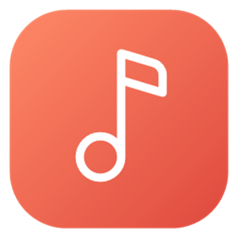

# Vibra

**Tu música de YouTube Music, con alma nativa de Windows 11.**  
Rápida, fluida, con Automix inteligente, letras sincronizadas y modo sin conexión.

 

[-FF5A52?style=for-the-badge)](https://github.com/vbr-builds/vbr-dist-7k9x/releases/latest/download/Vibra-Setup-0.2.0.exe)
&nbsp;&nbsp;
[-2D333B?style=for-the-badge)](https://github.com/vbr-builds/vbr-dist-7k9x/releases/latest/download/Vibra-0.2.0-win-x64.zip)

---

## ✨ ¿Qué hace especial a Vibra?

### 🎚️ Audio hecho para disfrutar
* **Automix inteligente con igualación de BPM:** Analiza la curva de energía, el volumen real y el tempo (BPM) de cada canción en segundo plano. Salta silencios iniciales y finales, detecta cuándo cae la energía en *outros* largos, iguala suavemente los BPM entre pistas de ritmo cercano y nivela el volumen.
* **Formato exclusivo `.vbr` para modo sin conexión:** Las descargas y la caché se guardan cifradas en el contenedor propio `.vbr`, decodificándose en memoria RAM al vuelo únicamente dentro de Vibra.
* **Crossfade suave:** Fundido de potencia constante (curva seno/coseno) sin caídas de volumen entre pistas ni cortes en audífonos Bluetooth.
* **Ecualizador de 10 bandas:** Preamp + 10 bandas de `−20 dB` a `+20 dB` con ajustes predefinidos (Rock, Pop, Bajo, Clásica…) que se escuchan al instante.
* **Calidad adaptable:** Elige entre **Alta**, **Normal**, **Ahorro de datos** o **Automática** (cambia sola según estés en Wi-Fi/cable o datos medidos). La pantalla de reproducción muestra siempre el códec y los kbps reales que están sonando.
* **Velocidad y Temporizador:** Reproducción de `0.75×` a `2×` y apagado programado (15–60 min o al terminar la canción actual).

### 🎨 Diseño nativo y vivo
* **Interfaz Windows 11 (Mica + Fluent):** Transiciones suaves, micro-animaciones elásticas en los controles y soporte completo para español e inglés.
* **Mini-reproductor flotante (*CompactOverlay*) y Controles en Barra de Tareas:**
  * Pasa el cursor sobre el icono de Vibra en la barra de tareas de Windows para controlar `⏮ Anterior`, `⏯ Play/Pausa` y `⏭ Siguiente` sin abrir la ventana (igual que Spotify).
  * Pulsa `Ctrl+M` para reducir Vibra a una ventana compacta siempre visible encima de tus otras apps, con portada, controles y la línea actual de la letra en vivo.
* **Pantalla *Reproduciendo ahora*:**
  * **Letras sincronizadas** con relleno progresivo palabra por palabra estilo karaoke (vía LRCLIB, NetEase y YouTube Music). Haz clic en cualquier verso para saltar a ese segundo exacto.
  * **Tinte ambiental dinámico** extraído del color dominante de la portada.
  * **Portada viva:** Se encoge suavemente al pausar y se transforma al cambiar de canción.
  * **Navegación directa a Álbum y Artista:** Salta al álbum completo o a las canciones del artista desde el menú `⋯` o pulsando sobre el nombre en el reproductor.

### 🎶 Tu música, a tu manera
* **Cola estilo Spotify + Radio inteligente:**
  * Al elegir una canción desde **Buscar**, suena al instante y alimenta automáticamente la cola con la radio de su mismo género y estilo.
  * **"Añadir a la cola"** coloca tus canciones justo a continuación de la que está sonando, respetando el orden en que las elegiste.
  * **Aleatorio inteligente (`✦`):** Mezcla tu cola e intercala sugerencias afines cada pocas canciones.
* **Descargas sin conexión:** Guarda canciones individuales, álbumes o playlists completas para escucharlas sin internet.
* **Memoria de sesión:** Si cierras la app, al volver recuerda tu cola, la canción, el segundo exacto y el volumen.
* **Cuenta de Google (100% opcional y cifrada):**
  * Adapta el Inicio y las radios a tus gustos, importa tus *"Me gusta"* y sincroniza los corazones que marques.
  * Tus cookies de sesión se guardan cifradas en tu equipo mediante **Windows DPAPI** (solo tu usuario de Windows puede leerlas).

---

## ⌨️ Atajos de teclado

| Atajo | Acción |
| :--- | :--- |
| `Espacio` o `Ctrl + Espacio` | Reproducir / Pausar |
| `Ctrl + →` / `Ctrl + ←` | Canción siguiente / Canción anterior |
| `Ctrl + ↑` / `Ctrl + ↓` | Subir / Bajar volumen |
| `Ctrl + F` | Ir al buscador |
| `Ctrl + L` | Abrir / cerrar Letras |
| `Ctrl + Q` | Abrir / cerrar Cola de reproducción |
| `Ctrl + M` | Activar / salir del Mini-reproductor flotante (*Siempre visible*) |
| `Esc` | Cerrar la vista *Reproduciendo ahora* o salir del Mini-reproductor |
| `Teclas multimedia de Windows` | Play/Pausa, Siguiente, Anterior y controles en pantalla de bloqueo |

---

## 🚀 Instalación y actualizaciones

1. **Con instalador (Recomendado):**
   * Descarga y abre [**`Vibra-Setup-0.2.0.exe`**](https://github.com/vbr-builds/vbr-dist-7k9x/releases/latest).
   * Instala sin pedir permisos de administrador, crea los accesos directos y conserva siempre tu biblioteca y sesión al actualizar.
2. **Actualizaciones automáticas dentro de la app:**
   * Cuando salga una versión nueva, Vibra te avisará con una barra en la parte superior (*"Actualizar ahora"*) o desde **Acerca de → Buscar actualizaciones**, instalándola en un clic sin perder nada.

> [!TIP]
> **¿Aparece el aviso *"Windows protegió su PC"* (SmartScreen)?**  
> Al ser un proyecto independiente sin certificado comercial de pago, Windows puede mostrar este aviso la primera vez. Solo haz clic en **«Más información»** y luego en **«Ejecutar de todas formas»** (o haz clic derecho en el instalador → *Propiedades* → marca *Desbloquear* antes de abrirlo).

---

## 🔒 Privacidad

* **Todo queda en tu equipo:** Tu biblioteca, historial, caché de audio y sesión viven únicamente en `%LOCALAPPDATA%\Vibra`.
* **Sin telemetría ni rastreadores:** La app solo se conecta a YouTube Music, a los proveedores públicos de letras (LRCLIB / NetEase) y a GitHub Releases para comprobar si hay una actualización disponible.

---

## 📄 Licencia y créditos

Distribuido bajo licencia **GPL-3.0**.  
Reimplementación nativa en C# / WinUI 3 para Windows 11, inspirada en la idea original de [Convx](https://github.com/cosmictaserdev-creator/Convx) para Android.

*Proyecto independiente, no afiliado a YouTube ni a Google.*
